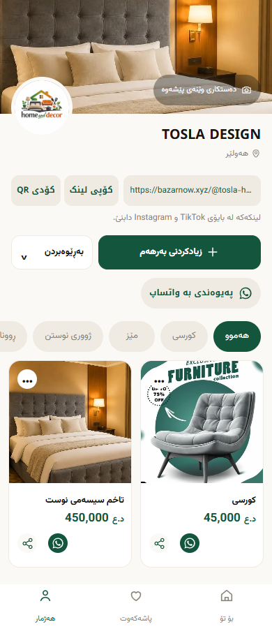

# Seller profile refresh

17 October 2026, Asia/Baghdad. Branch `codex/owner-profile-refresh`, based on latest main `cbc00b2f5bc6167a64fc7d8a9ae4a9b39b3cbb90`. This is an authenticated seller-profile change, inspired by the owner's mockup. Product/catalog values, badge claims and navigation come from existing code/data, not the reference image.

## What changed

- Owner-only styling for the responsive cover, logo, real shop name/location/bio, compact full-URL/copy/QR area, rounded product cards and existing contact links. Public shop/product presentation keeps its existing layout.
- One green Add Product link uses the existing `/app/new` plan flow. One native Management disclosure contains exactly Edit Profile, Settings, Manage Categories and View Public Shop. Enter/Space, Tab, arrow keys, Home/End, Escape and outside dismissal are supported. Settings Back returns focus to the visible Management trigger.
- Existing category chips scroll horizontally in RTL. The final action reads `+ زیادکردنی پۆلێن` and is revealed by scrolling. It opens the existing category editor focused on the new-category input. Management opens the same editor for rename/delete. Creation/rename/delete endpoints and confirmation remain; closing refreshes the existing chips/grid without changing the selected category query.
- An owner-scoped draft card appears only when unfinished work exists. It reuses the current IndexedDB draft, actual title and stored image Blob/key; the publishing URL, fields, photos, completion guard and logout cleanup remain. Completed work does not appear as unfinished. No placeholder draft/photo/count is rendered in the product UI.
- The same **three** bottom-navigation tabs remain. Social media, WhatsApp, QR/download routes, subscription Settings, product menus/edit/delete and permanent-Free publishing remain available. No verification badge, invented product statistic or new navigation tab.

### Confirmed data issue corrected

`getOwnShop()` selected only basic identity fields. Both the owner landing page and its protected stock/header fragment use that function, so their header could not receive saved cover/bio/social/map fields. Its explicit selection now includes the already-existing public profile fields. The `owner_id=eq.<authenticated user>`, user bearer, missing-user refusal and limit-one guard are unchanged. No private account fields or service role are introduced. A projection-aware unit check pins the required fields and ownership filter.

## Before / after

These are **local previews**, not production screenshots. They use cached public product photos/names/prices, synthetic category/draft state and the existing brand fonts. The test banner assignment is explained in [the fixture notes](../scripts/fixtures/owner-profile/README.md). No real seller draft or private login was accessed.

| Before: main, 390px | After: owner profile, 390px |
| --- | --- |
|  |  |

[320px before](images/owner-profile/before-320.png) · [320px after](images/owner-profile/after-320.png) · [360px](images/owner-profile/after-360.png) · [430px](images/owner-profile/after-430.png) · [desktop](images/owner-profile/after-1280.png)

[Draft present](images/owner-profile/after-draft-390.png) · [Management menu](images/owner-profile/management-390.png) · [Scrolled category-end action](images/owner-profile/category-end-390.png)

## Verification

Focused local browser run: **74 checks passed**. Widths 320/360/390/430/1280, real-font loading, no page overflow, action separation, visible 44px targets, bottom controls reachable above navigation, exactly three tabs, long name/maximum slug/missing images, empty stock, all social/contact links, copy, menu keyboard/focus behavior, Settings/subscription/support/logout, category selection/create/rename/delete/cancel, and draft thumbnail/data/completion.

The UI fixture runs the real renderer and shipped browser scripts with offline catalog/assets and a local in-memory category endpoint. It is presentation/interaction coverage, not proof of hosted authentication, database RLS or real device/printer behavior. The standard regression runner separately exercises the real local Worker against synthetic Supabase/Wayl/R2, plus real isolated PostgreSQL through PGlite.

Initial regression findings were retained:

1. Newly included legacy `categories-test.mjs` failed 13 assertions: nine expected the obsolete exact `/app` publish redirect, and four looked for a direct `products` insert. The existing production handler already returns `/app?published=<id>` and uses atomic `rpc/publish_product`. Updated only the test expectations to assert that exact redirect and inspect `p_values`; category/publishing production handlers were unchanged.
2. The next run exposed a race in the new UI test: it inspected the Node fixture's request log immediately after a click. The test now awaits the actual category-rename response before asserting, and awaits image decode for its draft thumbnail. The production category flow needed no workaround.

Evidence for these runs is ignored under `.local/owner-profile-first-regression/` and `.local/owner-profile-second-regression/`. Each intermediate combined run passed 20/21 groups; the first failed the obsolete category expectations, the second the new async assertion. Both issues are corrected and the failed evidence is retained.

**Final fresh `node scripts/run-permanent-free-tests.mjs`: 21/21 groups passed, exit 0.** Groups: database, image-sitemap, owner-profile UI, plan-state, limits, hardening, SEO, category API/publishing, category browser, Worker, Wayl, checkout retry, profile, publish, currency, visibility, affected rows, grants, owner product controls, browser/drafts and shop sharing.

Key counts: owner UI **74**, category API/publishing **64**, category browser **25**, SEO **106**, Wayl **128**, profile **52**, owner product controls **33**, browser/drafts **26**, sharing/QR **39**. Syntax **120 JavaScript files, zero failures**; diff whitespace passed. No native Worker crash occurred in the final run. Tests use synthetic local state and cannot initiate real Wayl payments.

A separate comparison against the unchanged-main archive confirmed public-shop HTML is byte-identical for the same public catalog fixture. Payment adapter, cron, database/migrations, product write handlers, Settings/profile-edit/product-page renderers, QR browser code and deployment configuration have no diff. Staged scope/credential checks are a basic guard, not a security certification.

Final results: ignored `.local/test-summary.json`, individual `*-results.txt`, `.local/syntax-results.json`, `.local/owner-profile-public-scope.json`. Screenshots were visually inspected after capture, including 320px, 390px, desktop, draft, Management and category-end states.

## Scope and release boundary

No migrations, hosted writes, R2 changes/deletions, account/subscription/payment changes, real payments, merge or production deployment. Wayl adapter/cron, pricing, database functions and profile-edit/Settings layouts are unchanged. Public data was read anonymously only to prepare offline screenshot fixtures.

Actual-device touch swiping, platform-native clipboard and physical QR printing were not manually exercised. Browser scrolling, copy mocks/fallback regressions, existing QR decode/download tests and existing payment security tests provide the automated evidence. No ranking/indexing or shopping-feed claims belong to this UI change.

NEXT ACTION: review the PR and screenshots. No deployment or merge is authorized by this task.
